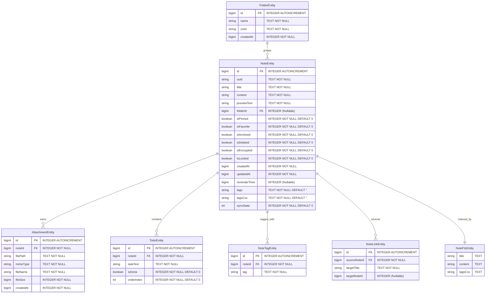
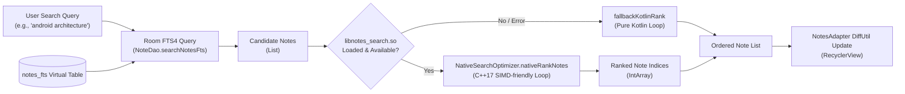
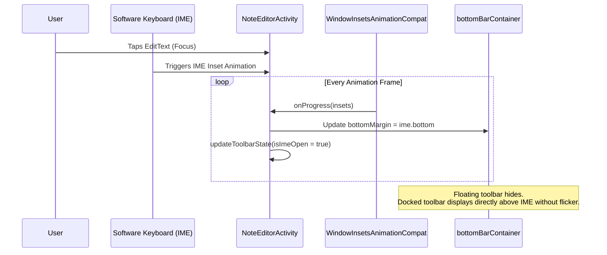
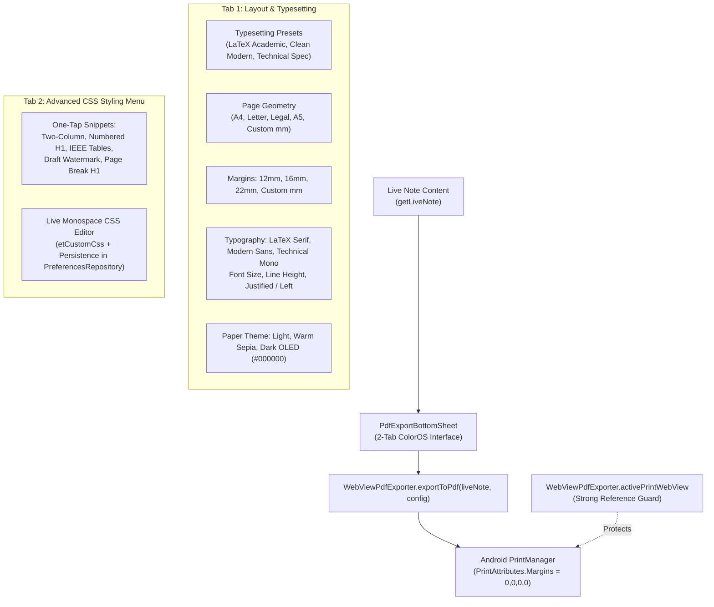
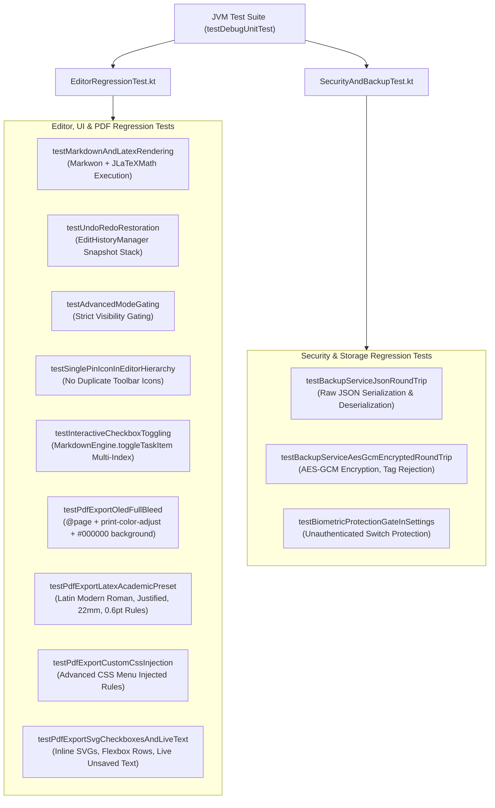

# LightNotes Technical Architecture & System Design

**LightNotes** (`com.lightnotes.app`) is an offline-first, high-performance Technical Notebook and Developer Scratchpad for Android (minSdk 26, targetSdk 35, compileSdk 35). It is engineered in 100% Kotlin/JVM and C++17 NDK (zero Rust/Cargo, zero embedded Chromium runtimes), following modern Material 3 Expressive and ColorOS/Realme flat styling principles (1dp hairlines, 6dp–12dp radii, no pill buttons, no heavy gradients, pure OLED `#000000` dark mode).

> [!NOTE]
> This document is also available at [docs/ARCHITECTURE.md](file:///c:/Users/tanma/Downloads/rea-sandbox/LightNotes/docs/ARCHITECTURE.md).

---

## 1. System Architecture & High-Level Layering

LightNotes is structured into five distinct, loosely coupled architectural layers:

```mermaid
flowchart TD
    subgraph UI["1. Presentation & UI Layer (ViewBinding + M3 Expressive)"]
        MA["MainActivity\n(StaggeredGrid / List, FTS Search, Folder Tabs)"]
        EA["NoteEditorActivity\n(IME Insets Animation, Dual Toolbar, Live Preview)"]
        SA["SettingsActivity\n(Biometric Gate, SAF Export/Import, Storage Info)"]
        
        subgraph BottomSheets["Modal Bottom Sheets"]
            MS["MathStudioBottomSheet"]
            DW["DevToolsBottomSheet\n(Diff / JSON / Regex)"]
            TB["TableBuilderBottomSheet"]
            BT["BacklinksTocBottomSheet"]
            CC["CalloutCodeBottomSheet"]
            PE["PdfExportBottomSheet\n(LaTeX Presets + Advanced CSS Menu)"]
            RS["RealmeShareBottomSheet\n(Live-Text Share Flow)"]
            AA["AiAssistBottomSheet"]
        end
        
        subgraph Adapters["RecyclerView Adapters"]
            NA["NotesAdapter\n(DiffUtil, High-Refresh Rate)"]
            FTA["FolderTabAdapter"]
        end
    end

    subgraph EditorEngine["2. Editor & Rendering Engine Layer"]
        EHM["EditHistoryManager\n(450ms Coalescing, 100 Stack)"]
        ME["MarkdownEngine\n(Markwon 4.6.2 + JLaTeXMath 0.2.0)"]
        KR["KatexRenderer\n(Offscreen WebView + LruCache)"]
        MR["MermaidRenderer\n(Offscreen WebView + LruCache)"]
        WPE["WebViewPdfExporter\n(PrintManager + Full-Bleed OLED + LaTeX Styling)"]
    end

    subgraph DataLayer["3. Data & Persistence Layer"]
        ADB[("AppDatabase v2\n(Room SQLite + MIGRATION_1_2)")]
        ND["NoteDao\n(FTS4 Search, Tags, Backlinks Flow)"]
        FD["FolderDao\n(CRUD Operations Flow)"]
        PR["PreferencesRepository\n(DataStore: CSS & Presets)"]
        AP["AppPreferences\n(Static Context Cache)"]
    end

    subgraph NativeLayer["4. Native C++17 JNI Layer (notes_search)"]
        NSO["NativeSearchOptimizer\n(Kotlin JNI Bridge + Fallback)"]
        CPP["native_search.cpp\n(C++17, -O3, -flto, -fvisibility=hidden)"]
    end

    subgraph Services["5. Security, Background & Utility Services"]
        BH["BiometricHelper\n(AndroidX BiometricPrompt + Keystore)"]
        BS["BackupService\n(AES-256-GCM + PBKDF2WithHmacSHA256)"]
        ABW["AutoBackupWorker\n(WorkManager Periodic Worker)"]
        MMS["MarkdownMirrorService\n(SAF DocumentFile Mirroring)"]
        VNR["VoiceNoteRecorder\n(MediaRecorder M4A/AAC)"]
        AM["AttachmentManager\n(Internal Scoped Storage)"]
        QRC["QrCodeHelper\n(ZXing QR Matrix Generator)"]
        HRH["HighRefreshRateHelper\n(144Hz Display Mode + Choreographer)"]
    end

    MA --> NA
    MA --> FTA
    MA --> ND
    MA --> FD
    MA --> NSO
    MA --> HRH

    EA --> EHM
    EA --> ME
    EA --> ND
    EA --> FD
    EA --> BottomSheets
    EA --> WPE
    EA --> VNR
    EA --> AM
    EA --> HRH

    SA --> PR
    SA --> BS
    SA --> BH
    SA --> ABW

    NSO --> CPP
    ME --> KR
    ME --> MR
    ND --> ADB
    FD --> ADB
    PR --> AP
```



### Layer Responsibilities
1. **Presentation & UI Layer:** Implemented with Android ViewBinding over XML layouts adhering to Material 3 Expressive guidelines (`Theme.Material3Expressive.DayNight.NoActionBar`). Manages UI state with Kotlin Coroutines and reactive `Flow` collectors.
2. **Editor & Rendering Engine Layer:** Provides real-time typing input, snapshot-based undo/redo tracking, syntax parsing, and native `Spannable` generation for Markdown and LaTeX without Chromium overhead during active editing.
3. **Data & Persistence Layer:** Encapsulates Room SQLite database version 2, FTS4 full-text search tables, foreign-key relationships, and DataStore-backed preference stores.
4. **Native C++17 Layer:** Shared library `libnotes_search.so` compiled with C++17 optimizations (`-O3`, `-flto`, `-fvisibility=hidden`), providing multi-token conjunctive keyword ranking over candidate notes.
5. **Security, Background & Utility Services:** Handles hardware biometric verification, authenticated AES-GCM encrypted backup pipelines, periodic WorkManager schedules, and high refresh rate display switching.

---

## 2. Database Schema & Room Migrations (`com.lightnotes.app.data`)

LightNotes uses an AndroidX Room SQLite database (`light_notes_database`) version 2. The persistence model includes full-text search indexing, relational folder trees, media attachment metadata, bidirectional document linking, and tag indices.

### 2.1 Entity Relationship Diagram (ERD)



### 2.2 Schema Definitions

- **`notes` (`NoteEntity`):** Core storage table for notes. Tracks title, content, snippet preview, folder assignment, lifecycle states (`isPinned`, `isFavorite`, `isArchived`, `isDeleted`, `isLocked`), timestamps, and comma-separated tags.
- **`notes_fts` (`NoteFtsEntity`):** Virtual SQLite FTS4 table created with `content=`notes``. Maps `docid` directly to `notes.id` and indexes `title`, `content`, and `tagsCsv` using SQLite's native tokenizers.
- **`note_tags` (`NoteTagEntity`):** Normalized tag table for high-speed tag filtering. Indexed on `tag` and `noteId`.
- **`note_links` (`NoteLinkEntity`):** Tracks wiki-style `[[Note Title]]` backlinks. Contains source note ID, destination title string, and resolved destination note ID (if existing). Indexed on `sourceNoteId` and `targetTitle`.
- **`folders` (`FolderEntity`):** User categories with custom hex accent colors.
- **`attachments` (`AttachmentEntity`):** Scoped filesystem references to photos, voice recordings (`.m4a`), and PDF attachments.
- **`todos` (`TodoEntity`):** Standalone checklist tasks associated with notes.

### 2.3 Room Migration v1 $\rightarrow$ v2 (`MIGRATION_1_2`)

To ensure zero data loss when upgrading existing installs from schema version 1 to 2, `AppDatabase.MIGRATION_1_2` executes structured SQLite DDL statements:

```kotlin
val MIGRATION_1_2 = object : Migration(1, 2) {
    override fun migrate(db: SupportSQLiteDatabase) {
        // 1. Add new columns to notes table with safe try-catch blocks
        try { db.execSQL("ALTER TABLE notes ADD COLUMN isFavorite INTEGER NOT NULL DEFAULT 0") } catch (_: Exception) {}
        try { db.execSQL("ALTER TABLE notes ADD COLUMN isLocked INTEGER NOT NULL DEFAULT 0") } catch (_: Exception) {}
        try { db.execSQL("ALTER TABLE notes ADD COLUMN tagsCsv TEXT NOT NULL DEFAULT ''") } catch (_: Exception) {}

        // 2. Create FTS4 virtual table and populate initial indices
        db.execSQL("CREATE VIRTUAL TABLE IF NOT EXISTS notes_fts USING fts4(content=`notes`, title, content, tagsCsv)")
        try {
            db.execSQL("INSERT INTO notes_fts(docid, title, content, tagsCsv) SELECT id, title, content, tagsCsv FROM notes")
        } catch (_: Exception) {}

        // 3. Create note_tags table & indices
        db.execSQL("""
            CREATE TABLE IF NOT EXISTS note_tags (
                id INTEGER PRIMARY KEY AUTOINCREMENT NOT NULL,
                noteId INTEGER NOT NULL,
                tag TEXT NOT NULL
            )
        """)
        db.execSQL("CREATE INDEX IF NOT EXISTS index_note_tags_tag ON note_tags(tag)")
        db.execSQL("CREATE INDEX IF NOT EXISTS index_note_tags_noteId ON note_tags(noteId)")

        // 4. Create note_links table & indices
        db.execSQL("""
            CREATE TABLE IF NOT EXISTS note_links (
                id INTEGER PRIMARY KEY AUTOINCREMENT NOT NULL,
                sourceNoteId INTEGER NOT NULL,
                targetTitle TEXT NOT NULL,
                targetNoteId INTEGER
            )
        """)
        db.execSQL("CREATE INDEX IF NOT EXISTS index_note_links_sourceNoteId ON note_links(sourceNoteId)")
        db.execSQL("CREATE INDEX IF NOT EXISTS index_note_links_targetTitle ON note_links(targetTitle)")
    }
}
```

### 2.4 DataStore Preferences (`PreferencesRepository.kt`)

Application configuration is stored asynchronously in AndroidX DataStore (`lightnotes_preferences`):
- `isAdvancedModeFlow: Flow<Boolean>`: Gates developer tools, diff/JSON/regex workspaces, LaTeX studio, callouts, and table builders.
- `biometricLockEnabledFlow: Flow<Boolean>`: Controls master biometric lock enforcement across the app.
- `pdfCustomCssFlow: Flow<String>`: Persisted custom print CSS stylesheet definitions.
- `pdfPresetFlow: Flow<String>`: Active typesetting preset name (e.g., `"LaTeX Academic"`).
- `autoBackupIntervalHoursFlow: Flow<Int>`: Interval for background WorkManager backups.
- `autoBackupTreeUriFlow: Flow<String>`: Scoped Storage SAF directory URI for automated encrypted backups.
- `markdownMirrorUriFlow: Flow<String>`: Directory URI for continuous plaintext Markdown mirroring.
- `highRefreshRateEnabledFlow: Flow<Boolean>`: Toggles forced 120Hz/144Hz display mode override.

---

## 3. Hybrid Search Pipeline & Native C++17 Ranking

LightNotes features a two-stage hybrid search engine designed for near-instant search across thousands of technical notes without UI stutter:



### 3.1 Stage 1: Room SQLite FTS4 Candidate Retrieval
When the user types a query in `MainActivity`, the search string is formatted with SQLite prefix wildcards (`query*`) and executed via Room Flow:
```sql
SELECT notes.* FROM notes
JOIN notes_fts ON notes.id = notes_fts.docid
WHERE notes_fts MATCH :query AND notes.isDeleted = 0
ORDER BY notes.isPinned DESC, notes.updatedAt DESC
```

### 3.2 Stage 2: Native C++17 JNI Multi-Token Ranker (`native_search.cpp`)
Candidates are dispatched to `NativeSearchOptimizer.rankNotes(query, notes)`:
- **Conjunctive Matching:** All terms must appear in title or content, else candidate is discarded.
- **Exact Full Title Match:** `+100` bonus points.
- **Title Substring of Full Query:** `+40` bonus points.
- **Title Term Prefix Match:** `+60` points per term.
- **Title Term Substring Match:** `+35` points per term.
- **Content Term Occurrence:** `+15` points per term occurrence.
- **Compiler Flags:** `-std=c++17 -O3 -flto -fvisibility=hidden`.

---

## 4. Editor Lifecycle, IME Window Insets & State Management

### 4.1 Edge-to-Edge Insets & Animated IME Transitions



- **Window Setup:** In `onCreate()`, `enableEdgeToEdge()` is called alongside `windowSoftInputMode="adjustResize"`.
- **Zero-Flicker Layout Animation:** `ViewCompat.setWindowInsetsAnimationCallback` dynamically sets `bottomBarContainer.layoutParams.bottomMargin = ime.bottom`.
- **Dual Toolbar Architecture:**
  - **State A (Keyboard Closed):** `layoutFloatingToolbar` is visible (12dp corners, 1dp border). `layoutDockedToolbarContainer` is hidden.
  - **State B (Keyboard Open):** `layoutFloatingToolbar` is hidden; `layoutDockedToolbarContainer` is docked atop the soft keyboard.
  - **Preview Mode:** Both toolbars are completely hidden (`bottomBarContainer.visibility = View.GONE`).

### 4.2 Undo / Redo State Engine (`EditHistoryManager.kt`)
- **Snapshot Stack:** Maintains up to 100 snapshots of `EditSnapshot(text, selectionStart, selectionEnd, timestamp)`.
- **Temporal Coalescing:** Consecutive typing within 450ms is coalesced into a single step.
- **Immediate Breakpoints:** Newlines (`\n`) and jumps > 2 chars force immediate snapshot commits.
- **Re-entrancy Guard (`isRestoring`):** Disables watcher triggers during undo/redo restoration.

### 4.3 Interactive Checkbox Toggling in Preview Mode
An `OnTouchListener` on `tvNoteRendered` resolves tap line coordinates, identifies the index of the tapped `TaskListSpan`, and invokes `MarkdownEngine.toggleTaskItem(markdown, index)` to flip `- [ ]` $\leftrightarrow$ `- [x]`, `* [ ]` $\leftrightarrow$ `* [x]`, `+ [ ]` $\leftrightarrow$ `+ [X]` while preserving surrounding content and scroll position.

### 4.4 Live Unsaved Content Extraction & Parallel Database Synchronization
Whenever document sharing (`Share` text, image, markdown, or PDF) or `Export PDF` is triggered:
- **Real-Time String Extraction (`getLiveNote()`):** Directly reads active text from `binding.etNoteTitle` and `binding.etNoteContent` (falling back to `binding.tvNoteRendered` in preview mode) rather than passing a stale `currentNote` entity loaded during activity creation.
- **Parallel Asynchronous Persistence (`syncLiveNoteToDb()`):** Simultaneously dispatches an asynchronous Room `update`/`insert` on `Dispatchers.IO` along with tag and backlink synchronization, keeping the database in sync without requiring the user to save and exit.

---

## 5. Rendering & Document Export Pipelines

### 5.1 Native Spannable Rendering vs. WebView Overhead

| Dimension | Native Markwon + JLaTeXMath | Embedded Chromium WebView |
|---|---|---|
| **Memory Allocation** | **3–6 MB** (Native Android Views) | 60–120 MB per instance |
| **Startup / Render Latency** | **Instant (0–8 ms)** | 300–800 ms cold start |
| **Rendering Mechanism** | Android `Canvas` text spans & drawables | GPU-rendered DOM tree |
| **Scroll / Touch Framerate** | **Native 120 / 144 FPS** | 60 FPS capped with IPC input lag |

### 5.2 Markwon 4.6.2 & JLaTeXMath 0.2.0 Integration (`MarkdownEngine.kt`)
- `MarkwonInlineParserPlugin.create()` required for inline math tokenizing.
- `JLatexMathPlugin.create(fontSize, inlinesEnabled(true))` converts `$E = mc^2$` and `$$\int f(x) dx$$` into vector-rendered `JLatexMathSpan` drawables.
- Syntax highlighting via `Prism4j`.

### 5.3 Offscreen KaTeX & Mermaid WebViews (`KatexRenderer.kt`, `MermaidRenderer.kt`)
Headless offscreen WebViews render complex math matrices and Mermaid diagrams to `Bitmap` buffers, cached in memory via `LruCache<String, Bitmap>(50)`.

### 5.4 PDF Export Studio, LaTeX Academic Typesetting & Advanced CSS Menu (`WebViewPdfExporter.kt`, `PdfExportBottomSheet.kt`)



- **Full-Bleed OLED Black (`#000000`) & Paper Themes:**
  - Forces Chromium's print compositor to fill background colors across the entire physical page and margin boxes:
    ```css
    * { box-sizing: border-box; -webkit-print-color-adjust: exact !important; print-color-adjust: exact !important; }
    @page { size: <width> <height>; margin: <top> <right> <bottom> <left>; background-color: <bgColor>; }
    html, body { margin: 0; padding: 0; width: 100%; min-height: 100%; background-color: <bgColor> !important; color: <textColor> !important; }
    ```
  - In Dark OLED mode, `#000000` background is paired with `#F2F2F5` text and `#FFB200` accents. `PrintAttributes.Margins(0, 0, 0, 0)` is set on the Android print spooler so no white margin strip can appear.
- **Inline SVG Checkboxes & Margin Cutoff Elimination:**
  - Task lists (`- [ ]` / `- [x]`) are rendered as clean flexbox rows (`display: flex; align-items: flex-start; gap: 8pt; margin: 4pt 0;`) using `11pt × 11pt` inline vector SVGs (`#FFB200` fill with black checkmark when checked, `1.6pt` stroke when unchecked). Negative left margins (`margin-left: -20px`) are eradicated.
  - Strict block overflow rules prevent horizontal clipping:
    ```css
    p, li, blockquote { overflow-wrap: anywhere; word-break: break-word; }
    pre, code { white-space: pre-wrap; word-break: break-word; max-width: 100%; }
    table { width: 100%; max-width: 100%; border-collapse: collapse; table-layout: fixed; word-wrap: break-word; }
    img, svg, .katex-display { max-width: 100% !important; overflow-x: hidden; }
    ```
- **LaTeX Academic Preset:**
  - Classical serif typography (`"Latin Modern Roman", "Computer Modern", Georgia, "Noto Serif", serif`).
  - Auto-hyphenated text justification (`text-align: justify; hyphens: auto; text-justify: inter-word;`).
  - Generous `22mm` margins, crisp `0.6pt` section rule underlines under `h1`, centered display math equations, and a formal article title/date header.
- **Dedicated Advanced CSS Styling Menu:**
  - Monospace stylesheet editor (`etCustomCss`) pre-populated with preset declarations, persistent across sessions via `PreferencesRepository.setPdfCustomCss()`.
  - One-tap style snippets (tap to append or toggle off):
    - `Two-Column Layout`: `body { column-count: 2; column-gap: 18pt; } h1, h2 { column-span: all; }`
    - `Numbered Academic Headings`: `body { counter-reset: h1; } h1::before { counter-increment: h1; content: counter(h1) ". "; }`
    - `IEEE Bordered Tables`: `th, td { border: 0.75pt solid currentColor; padding: 5pt 7pt; } th { font-weight: 700; }`
    - `Draft Watermark`: `body::after { content: "DRAFT"; position: fixed; top: 45%; left: 25%; font-size: 72pt; opacity: 0.08; transform: rotate(-30deg); }`
    - `Page Break Before H1`: `h1 { page-break-before: always; } h1:first-of-type { page-break-before: auto; }`
- **Garbage Collection Guard:** `WebViewPdfExporter.activePrintWebView` preserves a strong static reference preventing premature GC destruction during asynchronous IPC printing.

---

## 6. Security, Biometric Authentication & Cryptography

### 6.1 Hardware Biometric Protection Gate (`BiometricHelper.kt`)
- `BIOMETRIC_STRONG or DEVICE_CREDENTIAL` authentication for individual note access.
- Settings deactivation gate requires biometric validation before toggling off the master lock.

### 6.2 Encrypted `.enotes` Backup Container (`BackupService.kt`)
- **Magic Identifier:** `ENOTES1` (7 bytes).
- **KDF:** `PBKDF2WithHmacSHA256` (10,000 iterations, 16-byte random salt, 256-bit derived key).
- **Cipher:** `AES/GCM/NoPadding` (12-byte random IV, 128-bit authentication tag).

### 6.3 Automated Background Backups (`AutoBackupWorker.kt`)
WorkManager periodic worker writing timestamped `.enotes` archives into SAF tree directories via `DocumentFile`.

---

## 7. Display Engineering & Performance Optimization

### 7.1 144Hz High Refresh Rate Engine (`HighRefreshRateHelper.kt`)
- **API 30+:** Queries `Display.supportedModes`, assigns `WindowManager.LayoutParams.preferredDisplayModeId` matching the highest refresh rate up to 144Hz.
- **API 35+:** Invokes `View.setRequestedFrameRate` with `REQUESTED_FRAME_RATE_CATEGORY_HIGH` on scrolling containers.

### 7.2 Binary Footprint
The debug APK measures **~11.67 MB (12,238,703 bytes)**, entirely free of Rust runtimes or embedded browser engines.

---

## 8. Automated Regression Testing Strategy

LightNotes maintains an automated JVM-based unit and regression test suite powered by **Robolectric 4.18.1** and **Espresso Core 3.6.1**, running in Gradle via `testDebugUnitTest` with `isIncludeAndroidResources = true`.

### 8.1 Test Suites Overview



### 8.2 Detailed Test Case Matrix

| Suite | Method | Verification Target |
|---|---|---|
| `EditorRegressionTest` | `testMarkdownAndLatexRendering` | Renders headers, bold text, inline LaTeX (`$E=mc^2$`), block LaTeX (`$$\frac{-b\pm\sqrt{b^2-4ac}}{2a}$$`), and task lists into `TextView` using `MarkdownEngine.render()`, verifying no exceptions are thrown. |
| `EditorRegressionTest` | `testUndoRedoRestoration` | Verifies `EditHistoryManager` initial state, pushes text mutations, confirms immediate snapshot commits, tests `undo()` text rollback, and validates `redo()` restoration. |
| `EditorRegressionTest` | `testAdvancedModeGating` | Launches `NoteEditorActivity` via `ActivityScenario` with `isAdvancedMode = false` and asserts `layoutAdvancedFormatting` is strictly `View.GONE`. |
| `EditorRegressionTest` | `testSinglePinIconInEditorHierarchy` | Traverses the entire `window.decorView` hierarchy to ensure the duplicate `btnPin` was eliminated and exactly one pin icon (`ivInlinePin`) exists in the editor metadata bar. |
| `EditorRegressionTest` | `testInteractiveCheckboxToggling` | Tests regex toggling on Markdown text containing multiple uncompleted and completed task items (`- [ ]`, `- [x]`, `* [ ]`, `+ [X]`), verifying that toggling task 0, 1, 2, or 3 flips only the targeted item while leaving headings and paragraphs untouched. |
| `EditorRegressionTest` | `testPdfExportOledFullBleed` | Verifies that `WebViewPdfExporter.buildHtmlDocument(...)` outputs `@page`, `print-color-adjust: exact !important`, `#000000` background, and `#F2F2F5` text in OLED mode. |
| `EditorRegressionTest` | `testPdfExportLatexAcademicPreset` | Verifies that selecting the LaTeX Academic preset generates classical serif typography (`Latin Modern Roman` / `Computer Modern`), justified text with auto-hyphens, `22mm` margins, `0.6pt` section rule underlines, and centered display equations. |
| `EditorRegressionTest` | `testPdfExportCustomCssInjection` | Verifies that custom CSS rules from the Advanced CSS Styling menu (e.g., two-column layouts) are injected directly into the HTML document's `<style>` block. |
| `EditorRegressionTest` | `testPdfExportSvgCheckboxesAndLiveText` | Verifies that task list items are rendered as flexbox rows with inline vector SVG checkboxes (`11pt × 11pt`), eliminates negative margins (`margin-left: -20px`), and reflects live unsaved editor text. |
| `SecurityAndBackupTest` | `testBackupServiceJsonRoundTrip` | Exports notes and folders to raw JSON and verifies lossless deserialization of all fields including LaTeX strings, pin states, and folder references. |
| `SecurityAndBackupTest` | `testBackupServiceAesGcmEncryptedRoundTrip` | Exports confidential notes using `exportEncrypted()`, verifies `ENOTES1` ciphertext generation, decrypts with the valid passphrase, and asserts that decryption fails with an authentication error when an incorrect passphrase is provided. |
| `SecurityAndBackupTest` | `testBiometricProtectionGateInSettings` | Launches `SettingsActivity`, simulates clicking the biometric toggle switch without hardware authentication, and verifies the switch reverts to checked and DataStore preference remains `true`. |
