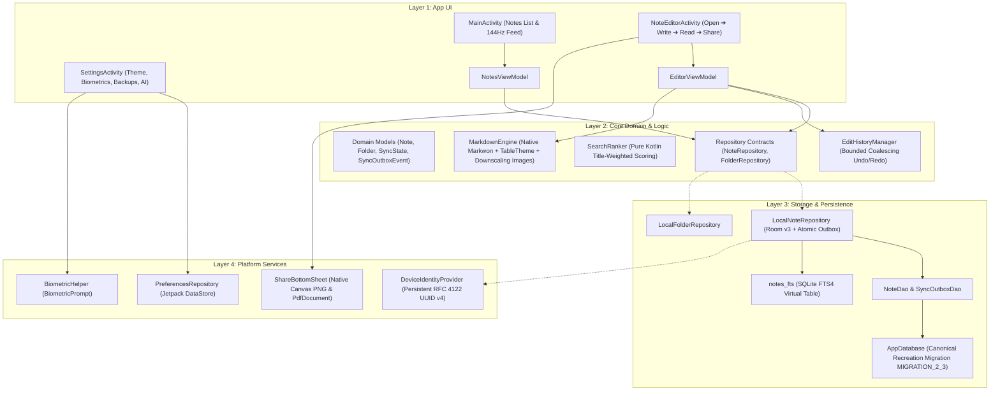

<div align="center">

# ⚡ LightNotes Lite

### *The 2.49 MB Local-First Technical Notebook for Android*

> **Open ➔ Write ➔ Read ➔ Share**  
> *Local-first now. Sync-ready by design. Cloud when needed.*

[-3DDC84?style=flat-square&logo=android&logoColor=white)](https://developer.android.com)
[](https://github.com/mt1240405/LightNotes/releases/tag/v1.2)
[](https://github.com/mt1240405/LightNotes/releases/tag/v1.2)
[](https://m3.material.io)
[](#-key-features)
[](LICENSE)

<br/>

**[📥 Download Latest Release APK (v1.2.0)](https://github.com/mt1240405/LightNotes/releases/tag/v1.2)** &nbsp;•&nbsp; **[📖 Architecture Guide](docs/ARCHITECTURE.md)** &nbsp;•&nbsp; **[📘 Complete User Guide](docs/USER_GUIDE.md)** &nbsp;•&nbsp; **[🔄 Sync Specification](docs/SYNC_ARCHITECTURE.md)**

<br/>

---

</div>

## 💡 Why LightNotes Lite?

Modern default note applications on phones (ColorOS Notes, Samsung Notes, Apple Notes, Google Keep) have quietly transformed into bloated 70–140 MB web portals. They take 1.5–2.5 seconds to open, force you past cloud account banners, render through heavy Chromium WebViews, and lock your technical notes into proprietary formats.

**LightNotes Lite was built to reject that bloat.** It is an uncompromising personal developer scratchpad and markdown notebook engineered with strict mechanical sympathy:

| Metric / Feature | Stock OEM Notes (ColorOS, Samsung, Apple) | LightNotes Lite v1.1 |
|:---|:---|:---|
| **Release APK Size** | 70 MB – 140 MB | **2.49 MB** *(Verified R8 + Resource Shrinking)* |
| **Debug APK Size** | 100 MB – 180 MB | **8.45 MB** |
| **Cold Startup to Typing** | 1,200ms – 2,500ms *(cloud sync banners, account checks)* | **< 100ms** *(Immediate editable surface)* |
| **Rendering Engine** | Chromium WebViews, JavaScript bridges, web DOM | **100% Pure Kotlin Android Views + Native Markwon** |
| **Native Toolchains** | Heavy C++ / Rust shared runtimes (.so bloat) | **Zero Rust, Zero NDK, 100% JVM Bytecode** |
| **Dark Theme** | Muddy grey/purple tonal elevation surfaces | **True `#000000` Zero-Pixel OLED Dark Mode** |
| **Display Refresh** | Clamped to 60Hz or jittery 90Hz | **Native 144Hz Peak Refresh Rate Orchestration** |
| **Data Ownership** | Proprietary cloud sync; export locked to vendor dumps | **Local SQLite FTS4 + Portable `lightnotes-backup` JSON** |
| **Sharing** | Watermarked PDFs, slow cloud invite links | **Native High-Res PNG, Multi-Page PDF, Markdown, Text** |
| **AI Integration** | Mandatory cloud telemetry & background trackers | **Zero-SDK BYOK (Bring Your Own Key), Off by default** |

---

## ✨ Key Features

### 🖤 True `#000000` OLED Dark Canvas & Material 3
* **Zero-Pixel Black:** True `#000000` canvas across all activities, app bars, and system navigation bars.
* **No Muddy Greys:** Material 3 surface elevation overlays are strictly disabled (`elevationOverlayEnabled = false`), keeping dark surfaces pure pitch-black.
* **Crisp Hierarchy:** Flat `#121214` note cards with subtle `1dp` `#242426` hairline borders and `14dp` rounded corners. Popups and bottom sheets use `#1C1C1E` surfaces with `16–20dp` corners.
* **Refined Typography:** Primary text in anti-glare `#F5F5F7` off-white, secondary metadata in `#8E8E93` (`13sp`), and signature `#FFB200` amber gold accent.

### ✍️ Developer-Grade Markdown & Interactive Checklists
* **Instant Native Preview:** Fast Markwon markdown parsing with zero WebViews.
* **Interactive Preview Checkboxes:** Checkbox taps (`- [ ]` / `- [x]`) in preview mode compute touch slop accurately, flip the raw markdown tokens in-place, preserve scroll position, and trigger autosave seamlessly.
* **Spacious Tables & Code Blocks:** Custom `TableTheme` with `12dp` cell padding, styled `1dp` borders, and distinct header/odd row colors. Fenced code blocks sit on flat `#121214` backgrounds.
* **Lightweight `/` Slash Command Menu:** Type `/` anywhere to trigger a floating menu for instant inserts (`H1`, `H2`, `Checkbox`, `Bullet`, `Number`, `Image`, `Code`, `Quote`, `AI`).

### ↶ Pinned Undo & Redo Controls
* **Always in Reach:** Undo (`↶`) and Redo (`↷`) buttons are permanently pinned to the left of the bottom formatting toolbar—accessible instantly without horizontal scrolling while typing.
* **Adaptive Dimming:** Automatically dims (`alpha = 0.35f`) when the history stack is empty.

### 🗂️ Batch Multi-Select & Native ZIP Archive Export
* **Contextual Selection Bar:** Tap the selection icon or long-press any note card to enter batch mode with tactile checkmarks and vivid `#FFB200` amber borders.
* **Batch Operations:** Select All, Pin/Unpin, or Delete/Restore multiple notes in one tap.
* **Discrete ZIP Archive:** Export selected notes as an isolated `.zip` archive via `java.util.zip.ZipOutputStream` with ZERO external dependencies. Choose from Markdown, Plain Text, PDF (Light), PDF (OLED Dark), or PNG Images—each note is rendered individually into its own file with automatic filename deduplication (NO combined document merging).

### 📤 Zero-Dependency 1-Tap Document Export & OLED Dark PDF
Share individual notes instantly in any format with zero heavy export libraries:
* **📄 Multi-Page Document (PDF):** Generates standard printable A4 (595x842 pt) multi-page PDF documents with proportional table layouts and downsampled inline images via native `android.graphics.pdf.PdfDocument`.
* **🖤 OLED Dark PDF Mode:** Fill the entire A4 canvas with true `#000000` pitch black, `#F5F5F7` crisp off-white typography, and `#FFB200` amber accents.
* **🖼️ High-Resolution Card Image (PNG):** Renders a pixel-perfect 1080px note card with theme background, title, metadata timestamp, separator line, and wrapped typography via native `Canvas` + `Bitmap`.
* **📝 Raw Markdown (.md):** Exports standard Markdown files for Obsidian, Logseq, Notion, or GitHub.
* **📋 Clean Plain Text:** Copies or shares text with Markdown formatting tokens cleanly stripped.

### 🖼️ Zero-Library Local Inline Images
* Pick photos directly from your gallery via Android Jetpack `PickVisualMedia(ImageOnly)` with zero legacy storage permissions.
* Images are streamed to private internal storage (`filesDir/images/`) and referenced via standard Markdown ``.
* Decoded on background threads using Markwon's `ImagesPlugin` + `DefaultDownScalingMediaDecoder` with `BitmapFactory.Options(inSampleSize)` scaled to screen width—preventing OOM errors with **ZERO Coil or Glide overhead**.

### 📌 Add to Home Screen Shortcuts
* Pin any high-frequency note directly to your Android launcher home screen via `ShortcutManagerCompat.requestPinShortcut(...)` for instant one-tap access.

### 🤖 Tiny Zero-SDK BYOK AI Assistant *(Off by Default)*
* **Zero Bloat (~15 KB):** Built with pure `HttpURLConnection` and `org.json.JSONObject`. Zero external AI SDKs, zero third-party analytics, zero tracking.
* **Bring Your Own Key (BYOK):** Completely optional and disabled by default. Configure your endpoint URL (compatible with OpenAI, OpenRouter, Groq, DeepSeek, or local Ollama / LM Studio), model name, and API key in Settings.
* **1-Tap Actions:** Summarize note, fix grammar & tone, or convert messy text into clean Markdown, with an interactive preview dialog to Replace Selection, Replace Note, or Append.

### 🔒 Biometric Security & Portable Encrypted Backups
* **Biometric App Lock:** Secure your notes behind hardware fingerprint or facial authentication (`BiometricPrompt`).
* **Portable `lightnotes-backup` JSON:** Open, versioned JSON backup format preserving notes, folders, and timestamps.
* **AES-256-GCM Encrypted Archives (`.enotes`):** Passphrase-protected encrypted backups via standard `javax.crypto` (PBKDF2WithHmacSHA256, 10,000 iterations, 16-byte random salt, 12-byte IV).
* **HeyTap / ColorOS Notes Importer:** Built-in 1-tap migration for users moving away from stock Realme/OPPO notes backups.

### 🔍 SQLite FTS4 Full-Text Search
* Fast as-you-type search powered by SQLite FTS4 and a pure Kotlin `SearchRanker` that scores exact title matches, title prefixes, and pinned notes strictly above body matches.

---

## 🏛️ System Architecture

LightNotes Lite is organized into four strictly decoupled layers following a **Sync-Ready Local-First Architecture**:



> For the comprehensive 11-step synchronization specification (delta synchronization, CRDT LWW-element-set conflict resolution, and REST protocol design), read **[docs/SYNC_ARCHITECTURE.md](docs/SYNC_ARCHITECTURE.md)**.

---

## 📦 Verified Build Footprint

LightNotes Lite enforces a strict **Release APK budget under 10 MB**. Verified measurements with R8 code and resource shrinking:

| Variant | File | Size | Verification |
|:---|:---|:---|:---|
| **Release APK** | `app-release.apk` | **2.49 MB** (2,606,598 bytes) | **PASS (75% below 10 MB limit)** |
| **Debug APK** | `app-debug.apk` | **8.45 MB** (8,860,672 bytes) | Clean unminified debug build |

### How 5+ MB of Bloat Was Eliminated:
* ✂️ **NDK / C++ Subsystem Removed:** Replaced native C++ search with pure Kotlin `SearchRanker` + SQLite FTS4 (**-2.5 MB**).
* ✂️ **KaTeX & JLaTeXMath Removed:** Bundled math web assets and formula runtimes removed in favor of clean markdown text (**-1.8 MB**).
* ✂️ **Mermaid WebView Removed:** Diagram webviews removed in favor of native code fences and plaintext diagrams (**-1.2 MB**).
* ✂️ **Chromium PDF Exporter Removed:** Replaced with Android's native `android.graphics.pdf.PdfDocument` (**-1.1 MB**).
* ✂️ **Coil / Glide Image Loaders Removed:** Replaced with native `BitmapFactory.Options` downscaling decoder (**-0.8 MB**).
* ✂️ **ZXing QR Code Library Removed:** Replaced with Android's native Sharesheet (**-0.6 MB**).

---

## 🧪 Automated JVM Test Suite

LightNotes Lite is covered by 5 automated Robolectric + Espresso JVM test suites:

```powershell
.\gradlew.bat testDebugUnitTest
```

* `EditorRegressionTest.kt`: Markdown parsing, undo/redo state preservation, interactive checkbox touch toggling, formatting shortcuts (`Ctrl+B/I/Z/Y`), live unsaved text sharing.
* `SearchAndFolderTest.kt`: FTS4 search ranking (title matches strictly prioritized), exclusion of deleted notes, folder filtering, and note lifecycle.
* `SyncOutboxAndMigrationTest.kt`: Non-destructive Room `MIGRATION_2_3` from v2 (100% data preservation, canonical table recreation, UUID backfilling) and transactional outbox event logging.
* `BackupAndSecurityTest.kt`: JSON backup round-trip, AES-256-GCM `.enotes` encrypted archives, conflict safety, biometric authentication gate.
* `PerformanceBenchmarkTest.kt`: Search latency across 1,200 notes (< 100ms) and large 5,000-character Markdown rendering benchmark.

---

## 🔨 Building from Source

### Prerequisites
* JDK 17 (e.g. OpenJDK 17 or Microsoft JDK 17)
* Android SDK 35 (compileSdk 35, minSdk 26)

### Clone & Build
```bash
git clone https://github.com/mt1240405/LightNotes.git
cd LightNotes

# Run JVM Unit Tests
./gradlew testDebugUnitTest

# Build Optimized Release APK (2.49 MB)
./gradlew assembleRelease
# Output: app/build/outputs/apk/release/app-release.apk

# Build Debug APK
./gradlew assembleDebug
# Output: app/build/outputs/apk/debug/app-debug.apk

# Install Debug APK to Connected Device via ADB
adb install -r -d ./app/build/outputs/apk/debug/app-debug.apk
```

---

## 📂 Portable Backup Specification (`lightnotes-backup` v1)

Backups are completely open, human-readable JSON files:

```json
{
  "format": "lightnotes-backup",
  "version": 1,
  "exportedAt": "2026-11-24T17:00:00Z",
  "notes": [
    {
      "id": "550e8400-e29b-41d4-a716-446655440000",
      "title": "Architecture Overview",
      "content": "# Architecture Overview\nSystem design notes...",
      "createdAt": 1700000000000,
      "updatedAt": 1700005000000,
      "folder": "Engineering",
      "pinned": true,
      "favorite": false
    }
  ],
  "folders": [
    {
      "id": "330e8400-e29b-41d4-a716-446655440011",
      "name": "Engineering",
      "color": "#FFB200",
      "createdAt": 1700000000000
    }
  ]
}
```

---

## 📄 License

LightNotes Lite is open-source software licensed under the **[Apache License 2.0](LICENSE)**.
