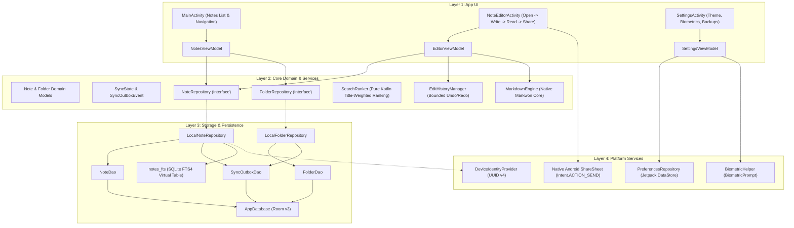

# LightNotes Lite — System Architecture Document
**Target Version:** LightNotes Lite v1.0 (v0.7-beta)  
**Status:** Living Engineering Standard  
**Architectural North Star:** *Local-first now. Sync-ready by design. Cloud when needed.*  
**Product Core Promise:** *Open -> Write -> Read -> Share*

---

## 1. Architectural Philosophy & Overview

LightNotes Lite is an ultra-fast, local-first technical notebook and developer scratchpad for Android. It eliminates heavy runtimes (zero Rust/Cargo, zero Node/JavaScript bridges, zero WebViews in the core editing and reading workflow) in favor of pure Kotlin/JVM, Android Views, Material 3 Expressive aesthetics, and native SQLite FTS4.

The system is decoupled into four strictly bounded logical layers:

---

## 2. Layer Breakdown & Boundaries

### Layer 1: App UI
* **Responsibility:** User presentation, gesture handling, touch responsiveness, 144Hz high refresh rate orchestration, and state observation.
* **Strict Boundary Rule:** UI components never communicate directly with Room DAOs or SQLite databases. All data flows through ViewModels (`NotesViewModel`, `EditorViewModel`, `SettingsViewModel`) observing `StateFlow` streams exposed by repository interfaces.

### Layer 2: Core Domain & Logic
* **Responsibility:** Platform-independent business logic, data models, search ranking, and text manipulation.
* **Domain Models:**
  * `Note`: UUID `globalId`, `title`, `content` (canonical Markdown), `folderGlobalId`, `createdAtUtc`, `updatedAtUtc`, `isPinned`, `isFavorite`, `isArchived`, `deletedAtUtc` (tombstone), `schemaVersion`, `revision`, `syncState`.
  * `Folder`: UUID `globalId`, `name`, `color`, `createdAtUtc`, `updatedAtUtc`, `deletedAtUtc`, `revision`, `syncState`.
  * `SyncOutboxEvent`: Transactional mutation event for offline delta synchronization.
* **Search Ranker:** Pure Kotlin title-weighted scoring algorithm prioritizing exact matches, title prefix matches, pinned items, and recency without NDK overhead.

### Layer 3: Storage & Persistence
* **Responsibility:** SQLite database management, schema migrations, transactional atomicity, and FTS virtual table maintenance.
* **Implementations:** `LocalNoteRepository` and `LocalFolderRepository` implement the core repository contracts and wrap all mutating operations in Room `@Transaction` blocks, guaranteeing that entity changes and outbox event insertions commit atomically.

### Layer 4: Platform Services
* **Responsibility:** Android OS integration, hardware biometrics, DataStore preferences, and the native Sharesheet.
* **Device Identity:** `DeviceIdentityProvider` generates an anonymous RFC 4122 UUID v4 on install, persisting it in DataStore to identify the origin device on sync events without requiring cloud accounts.

---

## 3. Database Architecture & Room v3 Schema

### 3.1 Migration Strategy (`MIGRATION_2_3`)
The database transitions from Room v2 to Room v3 non-destructively:
* **Zero Data Loss:** All existing rows in `notes` and `folders` are preserved with complete titles, contents, timestamps, pinned states, and favorite flags.
* **Sync-Ready Column Additions:**
  * `notes`: `global_id TEXT`, `folder_global_id TEXT`, `schema_version INTEGER`, `revision INTEGER`, `deleted_at_utc INTEGER`, `sync_state TEXT`.
  * `folders`: `global_id TEXT`, `deleted_at_utc INTEGER`, `revision INTEGER`, `sync_state TEXT`.
* **Backfilling:**
  * Existing `uuid` values are preserved as `global_id`, or generated via SQLite `hex(randomblob(...))` if null.
  * Tombstones (`deleted_at_utc`) are populated from `updatedAt` for legacy soft-deleted notes (`isDeleted = 1`).
  * `folder_global_id` references are resolved from legacy integer `folderId` values.
* **Legacy Tables Preserved:** Dormant tables (`attachments`, `todo`, `note_tags`, `note_links`) are left intact in SQLite to ensure no legacy data is lost.
* **Local Outbox Table:** `sync_outbox` table and indices (`syncStatus`, `createdAtUtc`) are created for Stage A offline mutation capture.

---

## 4. Note Editor Pipeline (`Open -> Write -> Read -> Share`)

### 4.1 Non-Blocking Autosave Pipeline
* Keystrokes directly mutate `etNoteTitle` and `etNoteContent`.
* Changes immediately mark in-memory state dirty, increment `documentRevision`, and update word count.
* A debounced coroutine (~400ms) persists the snapshot to Room on `Dispatchers.IO`.
* On activity lifecycle transitions (`onPause`, `onStop`), pending changes are synchronously flushed via `viewModel.flushSync()`.

### 4.2 Bounded Undo/Redo (`EditHistoryManager`)
* Coalesces rapid typing within a 450ms window to prevent ballooning memory.
* Retains exact cursor and selection positions across undo/redo actions.
* Hard cap of 100 snapshots, gracefully dropping the oldest entry when bounded capacity is reached.

### 4.3 Native Markdown Preview & Interactive Checklists
* Pure JVM native Markwon rendering without WebViews.
* Checkboxes (`- [ ]` / `- [x]`) in preview mode intercept touch events, toggle raw markdown via `MarkdownEngine.toggleTaskItem()`, update the editor in place, preserve scroll position, and trigger background autosave.

### 4.4 Instant Native Sharing (< 100ms)
* Reads live in-memory edit buffers immediately without requiring disk synchronization.
* Displays a 2-option ColorOS-styled bottom sheet:
  * **Share as Plain Text:** Markdown syntax is cleanly stripped while preserving structural readability.
  * **Share as Markdown:** Raw `.md` source passed with Android's native `Intent.ACTION_SEND` Sharesheet.

---

## 5. Bloat Removal & Pruning Rationale

| Pruned Subsystem | Rationale | Replaced With | APK Savings |
|:---|:---|:---|:---|
| **C++17 NDK / JNI Search** | Native compiler overhead, ABI bloat, slow build times | Pure Kotlin `SearchRanker` + SQLite FTS4 | ~2.5 MB |
| **KaTeX & JLaTeXMath** | Bundled JS/CSS web assets, heavy formula engine | Clean native text & Markwon core | ~1.8 MB |
| **Mermaid Diagram Engine** | Bundled `mermaid.html` WebView bridge | Plain code fences & diagrams | ~1.2 MB |
| **AI Assistant Client** | Out of scope for a private local-first scratchpad | Minimal offline workflow | ~0.5 MB |
| **Developer Toolbox** | Niche formatting tools cluttering the editor | Clean lightweight scratchpad | ~0.4 MB |
| **WebView PDF Exporter** | Heavy Chromium print compositor and custom CSS editor | Native plain text & `.md` share | ~1.1 MB |
| **ZXing QR Codes** | Heavy barcode matrix generation libraries | Native Android Sharesheet | ~0.6 MB |
| **WorkManager Background** | Persistent background battery consumption | On-demand SAF JSON backup | ~0.8 MB |

---

## 6. Automated Test Coverage Matrix

The codebase is backed by a 5-suite Robolectric + Espresso JVM test suite (`app/src/test/java/com/lightnotes/app/`):

1. **`EditorRegressionTest.kt`:**
   * Plain-text typing and live text capture.
   * Native Markdown preview rendering across all standard syntax and malformed input resilience.
   * Interactive preview checkbox toggles and markdown source synchronization.
   * Formatting selection wrap and cursor insertion without text truncation.
   * Undo/Redo stack restoration and selection position preservation.
   * Physical hardware keyboard shortcuts (`Ctrl+B`, `Ctrl+I`, `Ctrl+Z`, `Ctrl+Y`).
   * Live unsaved text propagation to Android's native share intent.
2. **`SearchAndFolderTest.kt`:**
   * Offline FTS4 search ranking title matches strictly above body matches.
   * Exclusion of deleted/trashed notes from search results.
   * Folder filtering, note moving, and folder lifecycle.
   * Pinning, favoriting, and soft-delete/restore/empty trash cycles.
3. **`SyncOutboxAndMigrationTest.kt`:**
   * Verification of `MIGRATION_2_3` from legacy Room v2: 100% data preservation, UUID backfilling, tombstone backfilling, legacy table retention.
   * Atomic `sync_outbox` event logging with persistent `deviceId` and monotonically incrementing revisions.
4. **`BackupAndSecurityTest.kt`:**
   * Full round-trip validation of portable `lightnotes-backup` v1 JSON schema.
   * Passphrase-protected AES-256-GCM `.enotes` encrypted export and import.
   * Non-destructive conflict safety on import (newer timestamp preservation).
   * Biometric app lock authentication gate in `SettingsActivity`.
5. **`PerformanceBenchmarkTest.kt`:**
   * In-memory search ranking latency across 1,200 generated notes (< 100ms).
   * Large 5,000+ character Markdown document rendering performance (< 1000ms under CPU emulation).
