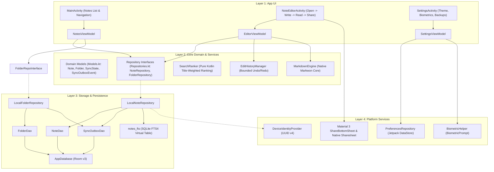

# LightNotes Lite — System Architecture Document
**Target Version:** LightNotes Lite v1.1.0  
**Status:** Living Engineering Standard  
**Architectural North Star:** *Local-first now. Sync-ready by design. Cloud when needed.*  
**Product Core Promise:** *Open -> Write -> Read -> Share*

---

## 1. Architectural Philosophy & Overview

LightNotes Lite is an ultra-fast, local-first technical notebook and developer scratchpad for Android. It eliminates heavy runtimes (zero Rust/Cargo, zero Node/JavaScript bridges, zero WebViews in the core editing and reading workflow) in favor of pure Kotlin/JVM, Android Views, Material 3 Expressive aesthetics, and native SQLite FTS4.

The system is decoupled into four strictly bounded logical layers:



---

## 2. Layer Breakdown & Boundaries

### Layer 1: App UI
* **Responsibility:** User presentation, gesture handling, touch responsiveness, 144Hz high refresh rate orchestration, and state observation.
* **Strict Boundary Rule:** UI components never communicate directly with Room DAOs or SQLite databases. All data flows through ViewModels (`NotesViewModel`, `EditorViewModel`, `SettingsViewModel`) observing `StateFlow` streams exposed by repository interfaces.

### Layer 2: Core Domain & Logic
* **Responsibility:** Platform-independent business logic, data models, search ranking, and text manipulation.
* **Domain Models:**
  * `Note`: UUID `globalId`, `title`, `content` (canonical Markdown), `folderGlobalId`, `createdAtUtc`, `updatedAtUtc`, `isPinned`, `isFavorite`, `isArchived`, `deletedAtUtc` (tombstone), `schemaVersion`, `revision`, `syncState`.
  * `Folder`: UUID `globalId`, `name`, `color`, `createdAtUtc`, `updatedAtUtc`, `deletedAtUtc`, `revision`, `syncState`.
  * `SyncOutboxEvent`: Transactional mutation event for offline delta synchronization.
* **Search Ranker:** Pure Kotlin title-weighted scoring algorithm prioritizing exact matches, title prefix matches, pinned items, and recency without NDK overhead.

### Layer 3: Storage & Persistence
* **Responsibility:** SQLite database management, schema migrations, transactional atomicity, and FTS virtual table maintenance.
* **Implementations:** `LocalNoteRepository` and `LocalFolderRepository` implement the core repository contracts and wrap all mutating operations in Room `@Transaction` blocks, guaranteeing that entity changes and outbox event insertions commit atomically.

### Layer 4: Platform Services
* **Responsibility:** Android OS integration, hardware biometrics, DataStore preferences, and the native Sharesheet.
* **Device Identity:** `DeviceIdentityProvider` generates an anonymous RFC 4122 UUID v4 on install, persisting it in DataStore to identify the origin device on sync events without requiring cloud accounts.

---

## 3. Database Architecture & Room v3 Schema

### 3.1 Migration Strategy (`MIGRATION_2_3`)
The database transitions from Room v2 to Room v3 non-destructively using a robust **Canonical SQLite Table Recreation** pattern:
* **Zero Data Loss Guarantee:** 100% of existing rows across `notes` and `folders` are preserved with full fidelity (all titles, contents, timestamps, pinned states, and favorite flags intact).
* **Canonical Schema Recreation:** Rather than relying on fragile, incremental `ALTER TABLE` statements—which cannot drop columns or modify default value string representations across Android SQLite versions—`MIGRATION_2_3` inspects existing tables dynamically via `PRAGMA table_info` and reconstructs `notes` and `folders` via temporary tables (`notes_temp`, `folders_temp`). This pattern:
  * Creates clean tables matching Room's compiled schema (`RoomOpenHelper.onValidateSchema()`) with 1:1 precision.
  * Strips obsolete legacy columns from previous v2 iterations (such as `syncState: Int`).
  * Normalizes column default values to eliminate SQLite metadata discrepancies (`defaultValue = null` vs `'undefined'`).
  * Transfers all data safely, gracefully falling back to defaults if optional columns are absent in older builds.
* **Sync-Ready Column Additions & Backfilling:**
  * `notes`: `global_id TEXT NOT NULL DEFAULT ''`, `folder_global_id TEXT`, `schema_version INTEGER NOT NULL DEFAULT 1`, `revision INTEGER NOT NULL DEFAULT 1`, `deleted_at_utc INTEGER`, `sync_state TEXT NOT NULL DEFAULT 'LOCAL_ONLY'`.
  * `folders`: `global_id TEXT NOT NULL DEFAULT ''`, `deleted_at_utc INTEGER`, `revision INTEGER NOT NULL DEFAULT 1`, `sync_state TEXT NOT NULL DEFAULT 'LOCAL_ONLY'`.
  * Existing `uuid` values are preserved as `global_id`, or generated via SQLite random UUID blobs if missing or empty.
  * Tombstones (`deleted_at_utc`) are backfilled from `updatedAt` for legacy soft-deleted notes (`isDeleted = 1`).
  * `folder_global_id` UUID foreign keys are automatically backfilled by querying the associated folder's `global_id`.
* **Legacy Tables & Index Consistency:**
  * Dormant legacy tables (`attachments`, `todos`, `note_tags`, `note_links`) are fully retained.
  * Secondary indices on `note_tags` (`index_note_tags_tag`, `index_note_tags_noteId`) and `note_links` (`index_note_links_sourceNoteId`, `index_note_links_targetTitle`) are explicitly created if absent.
* **Local Outbox & FTS4 Maintenance:**
  * `sync_outbox` table and compound indices (`syncStatus`, `createdAtUtc` & `entityId`, `localRevision`) are created for Stage A offline mutation capture.
  * `notes_fts` FTS4 virtual table is refreshed and repopulated with active non-deleted notes, with content synchronization triggers regenerated in `onPostMigrate()`.

---

## 4. Note Editor Pipeline (`Open -> Write -> Read -> Share`)

### 4.1 Non-Blocking Autosave Pipeline
* Keystrokes directly mutate `etNoteTitle` and `etNoteContent`.
* Changes immediately mark in-memory state dirty, increment `documentRevision`, and update word count.
* A debounced coroutine (~400ms) persists the snapshot to Room on `Dispatchers.IO`.
* On activity lifecycle transitions (`onPause`, `onStop`), pending changes are synchronously flushed via `viewModel.flushSync()`.

### 4.2 Bounded Undo/Redo (`EditHistoryManager`)
* Coalesces rapid typing within a 450ms window to prevent ballooning memory.
* Retains exact cursor and selection positions across undo/redo actions.
* Hard cap of 100 snapshots, gracefully dropping the oldest entry when bounded capacity is reached.

### 4.3 Native Markdown Preview, Tables & Interactive Checklists
* Pure JVM native Markwon rendering without WebViews.
* **Native TableLayout Rendering (`MarkdownTableHelper`):**
  * Markdown content is parsed into alternating Prose blocks and Markdown Table blocks while respecting code fence boundaries (` ``` ` and `~~~`).
  * Table rows are pre-normalized before rendering: `<br>`, `<br/>`, and `<br />` variants are converted to real `\n` newlines, bare autolinks (`<https://...>`) are converted to standard clickable Markdown links, and column counts across all data rows are strictly normalized (padded with empty cells or trimmed) to match the header column count.
  * Each table block renders inside a native `HorizontalScrollView` containing a `TableLayout` with individual `TableRow` and `TextView` cells (`minWidth = 88dp`, `maxWidth = 240dp`, `padding = 12dp`, `textSize = 14sp`, `lineSpacingMultiplier = 1.25f`, `LinkMovementMethod`).
  * Tables are styled with 1dp `#2C2C2E` borders (dark) / `#D1D1D6` (light), `#1C1C1E` header background (dark) / `#F2F2F7` (light), and alternating `#0D0D0F` / `#000000` rows (dark) or `#FAFAFC` / `#FFFFFF` (light).
* **Touch-Accurate Checkbox Toggling Across Multi-Segment Documents:**
  * In preview mode, each prose `TextView` receives an `OnTouchListener` that captures `ACTION_DOWN` coordinates and validates tap slop (`distance < scaledTouchSlop`) on `ACTION_UP`.
  * Checkbox indices are synchronized globally using `checkboxOffset = runningCheckboxCount`, allowing the user to tap checkboxes in any prose section above or below tables, flip the matching `$k$-th` Markdown token (`- [ ]` <-> `- [x]`) in raw Markdown via `MarkdownEngine.toggleTaskItem()`, preserve `NestedScrollView.scrollY`, and dispatch autosave.

### 4.4 Material 3 Edge-to-Edge Window Insets
* Edge-to-edge layout is orchestrated via `ViewCompat.setOnApplyWindowInsetsListener`:
  * **Top Toolbar:** `paddingTop = sysBars.top` ensures the navigation buttons (`Back`, `Toggle Mode`, `Share`, `Overflow Menu`) sit cleanly below the status bar clock and battery icons without layout overlap.
  * **Bottom Formatting Toolbar:** `paddingBottom = maxOf(sysBars.bottom, ime.bottom)` provides generous clearance above gesture navigation bars when closed, and sits flush with `8dp` padding directly above the keyboard when typing.
  * **Content ScrollView:** Adjusts bottom padding dynamically between editing mode and full-screen preview mode (`previewBottomPadding = sysBars.bottom`).

### 4.5 Material 3 Primary UI Components & True `#000000` OLED Hierarchy
* **Zero-Pixel OLED Palette:** The canvas sets `android:windowBackground`, `colorSurface`, `colorBackground`, and `colorSurfaceContainerLowest` to `#000000` in night mode, with tonal elevation disabled (`elevationOverlayEnabled = false`) to eliminate muddy grey/purple overlays.
* **Surface Hierarchy:**
  * **Note Cards:** Flat `#121214` surface with a crisp `1dp` `#242426` hairline border and `14dp` corner radius.
  * **Popups & Menus:** `#1C1C1E` surface with `1dp` `#242426` hairline border and `16dp` corner radius (`bg_m3_popup_surface`).
  * **Modal Bottom Sheets:** `#1C1C1E` surface with `20dp` top corner radius and `BottomSheetDragHandleView`.
* **Typography & Spacing Rhythm:** Primary text `#F5F5F7` (crisp off-white), secondary metadata `#8E8E93` (`13sp`), amber accent `#FFB200`. Clean `16dp` vertical rhythm between title (`22sp` bold), metadata row, and editor body (`16sp`, `1.4f` line spacing multiplier, `20dp` horizontal padding).

### 4.6 Pinned Undo/Redo & Formatting Toolbar
* **Fixed Thumb-Reach Controls:** The bottom toolbar anchors **Undo (`↶`)** and **Redo (`↷`)** fixed to the left of the container, outside the `HorizontalScrollView`. They are immediately accessible without horizontal scrolling during typing, dimming smoothly (`alpha = 0.35f`) when disabled.
* **Scrollable Formatting Tools:** Bold, Italic, Heading, Bullet List, Numbered List, Checklist, Image, Link, Code Block, and Blockquote scroll smoothly horizontally to the right.
* **Lightweight `/` Slash Command Popup:** Typing `/` opens an M3 `ListPopupWindow` for instant inline Markdown and AI inserts (`H1`, `H2`, `To-do`, `Bullet`, `Number`, `Image`, `Code`, `Quote`, `AI`).

### 4.7 Zero-Dependency Full Markdown Document Export Pipeline (`PdfExportHelper`)
* **Full Markdown PDF Rendering:** Exported PDFs render complete formatted Markdown (headings, bold, italic, bullet & numbered lists, interactive checkboxes, blockquotes, code blocks, and styled tables) without WebViews or third-party engines.
  * **Off-Screen Layout Measurement:** Builds an off-screen `LinearLayout` measured and laid out strictly at 1080px width using clean print palette styling (`#FFFFFF` background, `#111111` body text, `#555555` metadata, `#D1D1D6` hairline dividers and table borders, `#F2F2F7` code/table header backgrounds).
  * **Intelligent Split-Point Detection:** Scans child view layouts to detect exact candidate split points from line boundaries (`TextView.layout.getLineBottom(line)`) and row boundaries (`TableRow.bottom`).
  * **Clean Multi-Page Pagination:** Scales the 1080px layout onto standard A4 pages (595x842 pt, 40 pt margins, scale factor $515 / 1080 \approx 0.47685$) via `android.graphics.pdf.PdfDocument`. Pages break cleanly between lines or table rows without slicing characters or cells across page margins.
* **Full Markdown High-Res PNG Image:** Renders the 1080px layout onto a native `Bitmap` and `Canvas` with theme-aware palettes (pure OLED `#000000` dark or `#FFFFFF` light), compressing to lossless PNG in `cacheDir/shared_notes/`.
* **Security & Sandboxing:** Exported files are served exclusively through `FileProvider` (`${applicationId}.fileprovider`) with temporary read permissions.

### 4.8 Zero-Library Local Inline Images Pipeline
* **Photo Picker:** Uses standard Android Jetpack `PickVisualMedia(ImageOnly)` contract, eliminating legacy storage permission requirements.
* **Local Isolation:** Selected images are streamed into private internal storage (`filesDir/images/img_<timestamp>.jpg`), referenced as standard Markdown ``.
* **Off-Thread Downsampled Rendering:** Markwon's `ImagesPlugin` is registered with `FileSchemeHandler` and `DefaultDownScalingMediaDecoder`, decoding images on background threads via `BitmapFactory.Options(inSampleSize)` downsampled to display width, preventing OOM crashes and eliminating heavy Coil/Glide dependencies.

### 4.9 Add to Home Screen Shortcuts
* Pin any note directly to the Android launcher via `ShortcutManagerCompat.requestPinShortcut(...)`.
* Configures `ShortcutInfoCompat` with deep-link intent (`Intent.ACTION_VIEW` targeting `NoteEditorActivity` with note UUID and local ID) and app icon.

### 4.10 Tiny Zero-SDK BYOK AI Assistant Pipeline
* **Design Philosophy:** Minimal (~15 KB bytecode), zero external AI SDKs, off by default, 100% private.
* **Architecture:** Communicates directly with user-configured OpenAI-compatible endpoints (`https://api.openai.com/v1/chat/completions`, OpenRouter, Groq, DeepSeek, or local Ollama/LM Studio) via standard `java.net.HttpURLConnection` and `org.json.JSONObject`.
* **Security:** API key is stored locally in Jetpack DataStore preferences with zero telemetry.
* **Actions:** One-tap `Summarize`, `Fix Grammar & Tone`, and `Format as Clean Markdown` with interactive preview dialog to Replace Selection, Replace Note, or Append.

---

## 5. Bloat Removal & Pruning Rationale

| Pruned Subsystem | Rationale | Replaced With | APK Savings |
|:---|:---|:---|:---|
| **C++17 NDK / JNI Search** | Native compiler overhead, ABI bloat, slow build times | Pure Kotlin `SearchRanker` + SQLite FTS4 | ~2.5 MB |
| **KaTeX & JLaTeXMath** | Bundled JS/CSS web assets, heavy formula engine | Clean native text & Markwon core | ~1.8 MB |
| **Mermaid Diagram Engine** | Bundled `mermaid.html` WebView bridge | Plain code fences & diagrams | ~1.2 MB |
| **AI Assistant Client** | Out of scope for a private local-first scratchpad | Minimal offline workflow | ~0.5 MB |
| **Developer Toolbox** | Niche formatting tools cluttering the editor | Clean lightweight scratchpad | ~0.4 MB |
| **WebView PDF Exporter** | Heavy Chromium print compositor and custom CSS editor | Native plain text & `.md` share | ~1.1 MB |
| **ZXing QR Codes** | Heavy barcode matrix generation libraries | Native Android Sharesheet | ~0.6 MB |
| **WorkManager Background** | Persistent background battery consumption | On-demand SAF JSON backup | ~0.8 MB |

---

## 6. Automated Test Coverage Matrix

The codebase is backed by a 5-suite Robolectric + Espresso JVM test suite (`app/src/test/java/com/lightnotes/app/`):

1. **`EditorRegressionTest.kt`:**
   * Plain-text typing and live text capture.
   * Native Markdown preview rendering across all standard syntax and malformed input resilience.
   * Interactive preview checkbox toggles and markdown source synchronization.
   * Formatting selection wrap and cursor insertion without text truncation.
   * Undo/Redo stack restoration and selection position preservation.
   * Physical hardware keyboard shortcuts (`Ctrl+B`, `Ctrl+I`, `Ctrl+Z`, `Ctrl+Y`).
   * Live unsaved text propagation to Android's native share intent.
   * Multi-line `<br>` variants, uneven column padding/truncation, and autolink normalization in tables.
   * Native `TableLayout` creation and 1dp border/palette styling.
   * Valid `%PDF-` document export from rich Markdown documents without raw Markdown syntax leaks.
2. **`SearchAndFolderTest.kt`:**
   * Offline FTS4 search ranking title matches strictly above body matches.
   * Exclusion of deleted/trashed notes from search results.
   * Folder filtering, note moving, and folder lifecycle.
   * Pinning, favoriting, and soft-delete/restore/empty trash cycles.
3. **`SyncOutboxAndMigrationTest.kt`:**
   * End-to-end verification of `MIGRATION_2_3` from legacy Room v2 schemas via `Room.databaseBuilder(...).addMigrations(...)`:
     * Verifies that `RoomOpenHelper.onUpgrade()` and `RoomOpenHelper.onValidateSchema()` succeed with 0 warnings or schema mismatch errors.
     * Guarantees 100% data preservation across active notes, folders, and legacy tables (`attachments`, `todos`, `note_tags`, `note_links`).
     * Confirms UUID `globalId` backfilling, tombstone derivation, and `folder_global_id` cross-table resolution.
     * Verifies that Room DAO queries (`getNoteById()`, `getAllFoldersSync()`) operate seamlessly on the migrated database.
   * Atomic `sync_outbox` event logging with persistent `deviceId` and monotonically incrementing revisions.
4. **`BackupAndSecurityTest.kt`:**
   * Full round-trip validation of portable `lightnotes-backup` v1 JSON schema.
   * Passphrase-protected AES-256-GCM `.enotes` encrypted export and import.
   * Non-destructive conflict safety on import (newer timestamp preservation).
   * Biometric app lock authentication gate in `SettingsActivity`.
5. **`PerformanceBenchmarkTest.kt`:**
   * In-memory search ranking latency across 1,200 generated notes (< 100ms).
   * Large 5,000+ character Markdown document rendering performance (< 1000ms under CPU emulation).
