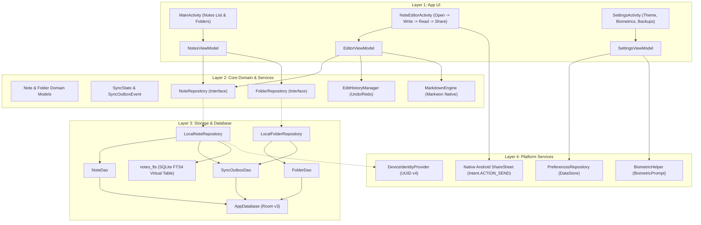
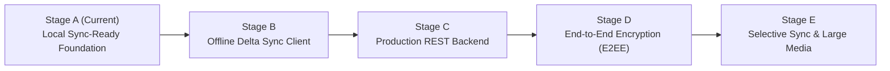

# LightNotes Lite — Sync-Ready Architecture Specification
**Document Version:** 1.0.0  
**Target Release:** LightNotes Lite v1.0 (v0.7-beta)  
**Status:** Approved Architectural Standard  

---

## 1. Executive Summary & Design Principles

LightNotes Lite is an ultra-lightweight, offline-first personal technical notebook designed for rapid capture, reading, editing, and sharing. The system adheres to two foundational axioms:

1. **Core Product Promise:** `Open -> Write -> Read -> Share` (Sub-100ms startup, immediate typing, native preview, instant plain-text/markdown sharing).
2. **Architectural North Star:** `Local-first now. Sync-ready by design. Cloud when needed.`

This document establishes the authoritative blueprint for transitioning from the legacy monolithic Room v2 schema to a clean **4-Layer Sync-Ready Architecture (Stage A)** that operates with 100% autonomy offline while remaining mathematically and semantically ready for bidirectional multi-device REST synchronization without data loss or breaking changes.

---

## 2. Assessment of Current Database (Room v2) & Storage Architecture

### 2.1 Existing Schema State
Under Room v2 (`AppDatabase.kt`), data is organized across the following entities:
* `notes` (`NoteEntity`): Primary key is an auto-incrementing SQLite integer `id: Long`. Also contains an unindexed `uuid: String`, `title`, `content`, `previewText`, `folderId: Long?`, `isPinned: Boolean`, `isFavorite: Boolean`, `isArchived: Boolean`, `isDeleted: Boolean`, `tagsCsv: String`, `createdAt: Long`, `updatedAt: Long`.
* `folders` (`FolderEntity`): Primary key is an auto-incrementing `id: Long`, with `name: String`, `color: String`, `createdAt: Long`.
* `notes_fts` (`NoteFtsEntity`): FTS4 virtual table indexing `docid`, `title`, `content`, `tagsCsv`.
* Legacy & Out-of-Scope Tables: `attachments`, `todo`, `note_tags`, `note_links`.

### 2.2 Critical Limitations for Multi-Device Synchronization
1. **Colliding Local Primary Keys:** Auto-incrementing integers (`id = 1, 2, 3...`) are locally scoped. If two devices create notes offline, both generate `id = 1`, resulting in key collisions upon synchronization.
2. **Lack of Global Folder Referencing:** Notes reference folders by `folderId: Long?` rather than a stable globally unique identifier (`folderGlobalId: String?`).
3. **Absence of Document Versioning:** The legacy schema lacks document revision counters (`revision: Long`) and schema versions (`schemaVersion: Int`). It is impossible to determine whether a change on Device A is a descendant or an ancestor of a change on Device B.
4. **Weak Deletion Tracking (Soft Deletes vs. Tombstones):** `isDeleted: Boolean` lacks an explicit UTC deletion timestamp (`deletedAtUtc: Long?`), preventing clean tombstone garbage collection and resurrection detection across clients.
5. **Missing Mutation Outbox:** Edits, moves, and deletions modify table rows in place without capturing a transactional change event log (`sync_outbox`). Offline mutations cannot be replayed incrementally.
6. **Direct DAO Invocations:** Activities and ViewModels frequently access DAOs directly without an abstracted repository contract, creating tight coupling between the UI and local SQLite tables.

---

## 3. Portable, Platform-Independent Domain Models

The Core domain layer is completely decoupled from Android framework types and Room annotations. All models represent pure, serializable Kotlin data classes.

### 3.1 Domain Model Definitions (`core/model/`)

#### Note Model
```kotlin
package com.lightnotes.app.core.model

import kotlinx.serialization.Serializable

@Serializable
data class Note(
    val localId: Long = 0,
    val globalId: String,               // UUID v4 (36 chars, canonical globally unique identifier)
    val title: String,
    val content: String,             // Canonical Markdown string
    val folderGlobalId: String? = null, // UUID v4 of parent folder
    val createdAtUtc: Long,             // Milliseconds since Unix epoch in UTC
    val updatedAtUtc: Long,             // Milliseconds since Unix epoch in UTC
    val isPinned: Boolean = false,
    val isFavorite: Boolean = false,
    val isArchived: Boolean = false,
    val deletedAtUtc: Long? = null,     // Tombstone timestamp; null indicates active note
    val schemaVersion: Int = 1,         // Payload schema version for forward compatibility
    val revision: Long = 1L,            // Monotonically increasing per-note modification counter
    val syncState: SyncState = SyncState.LOCAL_ONLY
)
```

#### Folder Model
```kotlin
package com.lightnotes.app.core.model

import kotlinx.serialization.Serializable

@Serializable
data class Folder(
    val localId: Long = 0,
    val globalId: String,               // UUID v4
    val name: String,
    val color: String = "#FFB200",
    val createdAtUtc: Long,
    val updatedAtUtc: Long,
    val deletedAtUtc: Long? = null,     // Tombstone timestamp
    val revision: Long = 1L,
    val syncState: SyncState = SyncState.LOCAL_ONLY
)
```

#### SyncState Enum
```kotlin
package com.lightnotes.app.core.model

enum class SyncState {
    LOCAL_ONLY,       // Note exists purely on local device; sync disabled or untracked
    PENDING_SYNC,     // Mutated locally; queued in outbox for upstream push
    SYNCHRONIZING,    // HTTP payload currently in flight
    SYNCHRONIZED,     // Acknowledged by upstream server; local revision matches server
    SYNC_FAILED,      // Network or transient error; retry scheduled
    CONFLICT_DETECTED // Divergent concurrent edits detected; requires resolution
}
```

#### SyncOutboxEvent Model
```kotlin
package com.lightnotes.app.core.model

import kotlinx.serialization.Serializable

@Serializable
data class SyncOutboxEvent(
    val eventId: String,                // UUID v4 uniquely identifying this mutation event
    val entityId: String,               // globalId of the mutated Note or Folder
    val entityType: SyncEntityType,     // NOTE, FOLDER
    val operationType: SyncOperation,   // CREATE, UPDATE, MOVE, ARCHIVE, DELETE
    val deviceId: String,               // UUID v4 identifying the originating device
    val localRevision: Long,            // Revision number resulting from this operation
    val createdAtUtc: Long,             // Milliseconds since Unix epoch in UTC
    val payloadJson: String,            // Serialized snapshot of entity state
    val syncStatus: OutboxStatus = OutboxStatus.PENDING
)

enum class SyncEntityType { NOTE, FOLDER }
enum class SyncOperation { CREATE, UPDATE, MOVE, ARCHIVE, DELETE }
enum class OutboxStatus { PENDING, IN_FLIGHT, ACKNOWLEDGED, FAILED }
```

---

## 4. Non-Destructive Room Database Migration Plan (v2 -> v3)

### 4.1 Strict Data Safety Guarantee
Existing user notes, timestamps, titles, contents, folders, pinned status, and favorite status MUST be preserved with 100% fidelity. Legacy tables (`attachments`, `todo`, `note_tags`, `note_links`) are retained intact as dormant tables in SQLite so no user data is destroyed.

### 4.2 Migration SQL Specification (`MIGRATION_2_3`)
```sql
-- Step 1: Add sync-ready columns to `notes` table
ALTER TABLE notes ADD COLUMN global_id TEXT NOT NULL DEFAULT '';
ALTER TABLE notes ADD COLUMN folder_global_id TEXT DEFAULT NULL;
ALTER TABLE notes ADD COLUMN schema_version INTEGER NOT NULL DEFAULT 1;
ALTER TABLE notes ADD COLUMN revision INTEGER NOT NULL DEFAULT 1;
ALTER TABLE notes ADD COLUMN deleted_at_utc INTEGER DEFAULT NULL;
ALTER TABLE notes ADD COLUMN sync_state TEXT NOT NULL DEFAULT 'LOCAL_ONLY';

-- Step 2: Backfill `global_id` from existing `uuid` column or generate RFC 4122 v4 UUIDs
UPDATE notes SET global_id = uuid WHERE uuid IS NOT NULL AND length(uuid) > 0;
UPDATE notes SET global_id = (
    lower(hex(randomblob(4))) || '-' ||
    lower(hex(randomblob(2))) || '-4' ||
    substr(lower(hex(randomblob(2))), 2) || '-a' ||
    substr(lower(hex(randomblob(2))), 2) || '-' ||
    lower(hex(randomblob(6)))
) WHERE global_id = '' OR global_id IS NULL;

-- Step 3: Backfill tombstones from legacy `isDeleted` flag
UPDATE notes SET deleted_at_utc = updatedAt WHERE isDeleted = 1 AND deleted_at_utc IS NULL;

-- Step 4: Add sync-ready columns to `folders` table
ALTER TABLE folders ADD COLUMN global_id TEXT NOT NULL DEFAULT '';
ALTER TABLE folders ADD COLUMN deleted_at_utc INTEGER DEFAULT NULL;
ALTER TABLE folders ADD COLUMN revision INTEGER NOT NULL DEFAULT 1;
ALTER TABLE folders ADD COLUMN sync_state TEXT NOT NULL DEFAULT 'LOCAL_ONLY';

UPDATE folders SET global_id = (
    lower(hex(randomblob(4))) || '-' ||
    lower(hex(randomblob(2))) || '-4' ||
    substr(lower(hex(randomblob(2))), 2) || '-a' ||
    substr(lower(hex(randomblob(2))), 2) || '-' ||
    lower(hex(randomblob(6)))
) WHERE global_id = '' OR global_id IS NULL;

-- Step 5: Map existing numeric folderId references to folder_global_id
UPDATE notes SET folder_global_id = (
    SELECT f.global_id FROM folders f WHERE f.id = notes.folderId
) WHERE folderId IS NOT NULL;

-- Step 6: Create `sync_outbox` table and performance indexes
CREATE TABLE IF NOT EXISTS sync_outbox (
    eventId TEXT PRIMARY KEY NOT NULL,
    entityId TEXT NOT NULL,
    entityType TEXT NOT NULL,
    operationType TEXT NOT NULL,
    deviceId TEXT NOT NULL,
    localRevision INTEGER NOT NULL,
    createdAtUtc INTEGER NOT NULL,
    payloadJson TEXT NOT NULL,
    syncStatus TEXT NOT NULL DEFAULT 'PENDING'
);

CREATE INDEX IF NOT EXISTS index_sync_outbox_status_created 
ON sync_outbox(syncStatus, createdAtUtc);

CREATE INDEX IF NOT EXISTS index_sync_outbox_entity 
ON sync_outbox(entityId, localRevision);

-- Step 7: Create indexes on global_id and sync_state
CREATE UNIQUE INDEX IF NOT EXISTS index_notes_global_id ON notes(global_id);
CREATE INDEX IF NOT EXISTS index_notes_folder_global_id ON notes(folder_global_id);
CREATE INDEX IF NOT EXISTS index_notes_sync_state ON notes(sync_state);
CREATE UNIQUE INDEX IF NOT EXISTS index_folders_global_id ON folders(global_id);

-- Step 8: Ensure FTS4 table is synchronized
DROP TABLE IF EXISTS notes_fts;
CREATE VIRTUAL TABLE notes_fts USING fts4(content=`notes`, title, content, tagsCsv);
INSERT INTO notes_fts(docid, title, content, tagsCsv) 
SELECT id, title, content, tagsCsv FROM notes WHERE deleted_at_utc IS NULL;
```

---

## 5. Local Transactional Change-Log / Outbox (`sync_outbox`)

### 5.1 Atomicity Guarantee
Every write operation (Create, Update, Archive, Move, Delete) in `LocalNoteRepository` or `LocalFolderRepository` MUST execute inside a Room `@Transaction`. The entity modification and the outbox event insertion commit together atomically. An application crash or battery exhaustion will never leave the database in a partially logged state.

### 5.2 Bounded Cleanup Semantics
To prevent unbounded database growth on offline-only devices:
1. **Acknowledged Event Pruning:** Any event marked `ACKNOWLEDGED` older than 7 days is purged via `DELETE FROM sync_outbox WHERE syncStatus = 'ACKNOWLEDGED' AND createdAtUtc < :cutoffTime`.
2. **Local-Only Coalescing:** When running in `LOCAL_ONLY` mode without an active sync account, consecutive `UPDATE` events for the same `entityId` overwrite the existing pending outbox entry with the newest snapshot and latest revision, capping total outbox rows.
3. **Hard Bounds:** If the outbox exceeds 1,000 pending items on a disconnected device, older historical updates for already-superseded entity revisions are compacted.

---

## 6. Device Identity (`DeviceIdentityProvider`)

Each installation generates a cryptographically random UUID v4 identifier (`deviceId`) on first startup:
* Persisted securely in Jetpack DataStore / EncryptedSharedPreferences.
* Read synchronously during application initialization and cached in-memory.
* Attached to every `SyncOutboxEvent` and HTTP sync request header (`X-Device-Id`).
* Completely independent of user accounts, email addresses, or phone numbers.
* Survives application updates and process recreation; reset only upon explicit user cache clearing or app uninstallation.

---

## 7. Vendor-Independent Versioned REST Synchronization API Specification

All timestamps are ISO-8601 UTC strings or 64-bit integer Unix millisecond epochs. All endpoints use standard HTTP status codes and `application/json` payloads.

### 7.1 Authentication & Device Registration

#### `POST /v1/auth/register`
Creates a user account on the sync server.
```json
// Request
{
  "email": "user@example.com",
  "passwordHash": "argon2id$v=19$m=65536,t=3,p=4$...",
  "clientSalt": "base64-random-salt"
}
// Response (201 Created)
{
  "userId": "usr_9b1deb4d-3b7d-4bad-9bdd-2b0d7b3dcb6d",
  "createdAt": "2026-11-24T00:00:00Z"
}
```

#### `POST /v1/auth/login`
Exchanges user credentials for a session token.
```json
// Request
{
  "email": "user@example.com",
  "passwordHash": "argon2id$v=19$m=65536,t=3,p=4$..."
}
// Response (200 OK)
{
  "userId": "usr_9b1deb4d-3b7d-4bad-9bdd-2b0d7b3dcb6d",
  "authToken": "eyJhbGciOiJIUzI1NiIsInR5cCI6IkpXVCJ9...",
  "expiresAt": "2026-12-24T00:00:00Z"
}
```

#### `POST /v1/devices/register`
Registers the local device under the authenticated user.
```json
// Headers: Authorization: Bearer <authToken>
// Request
{
  "deviceId": "dev_4a2c9183-f542-45e8-b98a-1c6e12e34567",
  "deviceModel": "Realme GT Neo 3T (Android 15)",
  "appVersion": "1.0.0"
}
// Response (200 OK)
{
  "deviceToken": "tok_dev_sec_991823746152",
  "registeredAt": "2026-11-24T00:00:00Z"
}
```

### 7.2 Bidirectional Synchronization Endpoints

#### `GET /v1/sync/changes?cursor={cursor}&limit={limit}`
Retrieves upstream changes since the last acknowledged cursor.
* **Cursor Semantics:** An opaque, monotonically increasing sequence string (`cur_10928374`). If `cursor` is omitted or empty, the server performs a full initial sync starting from sequence `0`.
* **Pagination:** Default limit is 100 items. When `hasMore` is true, the client requests the next batch using `nextCursor`.

```json
// Response (200 OK)
{
  "nextCursor": "cur_10928480",
  "hasMore": false,
  "changes": [
    {
      "entityType": "NOTE",
      "globalId": "550e8400-e29b-41d4-a716-446655440000",
      "operation": "UPDATE",
      "revision": 4,
      "updatedAt": 1795500000000,
      "payload": {
        "title": "Architecture Specification",
        "content": "# Architecture Specification\nCanonical Markdown content.",
        "folderGlobalId": "330e8400-e29b-41d4-a716-446655440011",
        "isPinned": true,
        "isFavorite": false,
        "isArchived": false,
        "deletedAt": null,
        "schemaVersion": 1
      }
    },
    {
      "entityType": "NOTE",
      "globalId": "770e8400-e29b-41d4-a716-446655440022",
      "operation": "DELETE",
      "revision": 2,
      "updatedAt": 1795500100000,
      "payload": {
        "deletedAt": 1795500100000
      }
    }
  ]
}
```

#### `POST /v1/sync/push`
Pushes a batch of local outbox mutations to the server.
* **Idempotency:** The client sends an `Idempotency-Key` header populated with the primary `eventId`. The server guarantees duplicate submissions within 24 hours are safely ignored.

```json
// Request
{
  "deviceId": "dev_4a2c9183-f542-45e8-b98a-1c6e12e34567",
  "events": [
    {
      "eventId": "evt_881923-1283-4918-a827-192837461524",
      "entityType": "NOTE",
      "globalId": "550e8400-e29b-41d4-a716-446655440000",
      "operation": "UPDATE",
      "baseRevision": 3,
      "targetRevision": 4,
      "timestamp": 1795500050000,
      "payload": {
        "title": "Architecture Specification (Updated)",
        "content": "# Updated Content",
        "folderGlobalId": null,
        "isPinned": true,
        "isFavorite": false,
        "isArchived": false,
        "deletedAt": null,
        "schemaVersion": 1
      }
    }
  ]
}
// Response (200 OK)
{
  "results": [
    {
      "eventId": "evt_881923-1283-4918-a827-192837461524",
      "globalId": "550e8400-e29b-41d4-a716-446655440000",
      "status": "ACCEPTED",
      "serverRevision": 4
    }
  ]
}
// Conflict Response (409 Conflict)
{
  "error": "REVISION_CONFLICT",
  "message": "Base revision 3 does not match current server revision 5",
  "conflicts": [
    {
      "eventId": "evt_881923-1283-4918-a827-192837461524",
      "globalId": "550e8400-e29b-41d4-a716-446655440000",
      "serverRevision": 5,
      "serverState": { ... }
    }
  ]
}
```

#### Error Code Reference
| Code | Identifier | Description | Client Action |
|:---|:---|:---|:---|
| `400` | `INVALID_SCHEMA` | Malformed JSON or unparseable field | Abort event, log locally |
| `401` | `UNAUTHORIZED` | Expired token or revoked device | Trigger token refresh or prompt login |
| `404` | `NOT_FOUND` | Referenced entity does not exist | Create entity as new or drop orphan |
| `409` | `REVISION_CONFLICT` | Stale `baseRevision` on push | Fork conflict note locally or auto-merge |
| `429` | `RATE_LIMITED` | Too many requests | Backoff exponentially with jitter |

---

## 8. Conflict Resolution Strategy

LightNotes intentionally avoids the mathematical complexity, CPU overhead, and data-bloat of Conflict-free Replicated Data Types (CRDTs) or Operational Transformation (OT). For a Markdown-based technical notebook, whole-document versioning with deterministic conflict preservation is superior in predictability and data safety.

### 8.1 Resolution Rules
1. **Independent Notes (Disjoint Edits):** If Device A modifies Note 1 and Device B modifies Note 2, both sync seamlessly without conflict.
2. **Sequential Edits on Same Note:** If Device A pushes revision 3 and Device B pulls revision 3 before editing, Device B's subsequent push increments to revision 4 smoothly.
3. **Concurrent Divergent Edits (Conflict Preservation):**
   * If Device A and Device B both base their changes on revision 3:
   * Device A pushes first -> Server accepts and increments to revision 4.
   * Device B pushes base revision 3 -> Server rejects with `409 Conflict` and returns current revision 4.
   * Device B marks the local note as `CONFLICT_DETECTED`.
   * **Automatic Fork:** Device B preserves the server's revision 4 as the canonical note, and automatically creates a new independent note titled `[Conflict Copy - Device B] {Original Title}` containing Device B's local edits, assigned a fresh `globalId` (UUID v4) and revision 1.
   * **Zero Data Loss:** Neither author's edits are ever overwritten or discarded. The user can review the conflict copy and merge manually using plain text or the Diff tool.
4. **Tombstone Deletion Propagation:** A deletion creates a tombstone record (`deletedAtUtc != null`) with an incremented revision.
   * If Note 1 is deleted on Device A (rev 4, tombstone) while Device B edited it concurrently (rev 4, active content), the active edit wins if its timestamp is newer, or the conflict copy is preserved while honoring the deletion.
   * Purging tombstones from local storage occurs only after all registered devices have acknowledged the deletion or after 30 days of tombstone presence.

---

## 9. Security, HTTPS, Revocable Credentials & Future E2EE

### 9.1 Transport & Authentication Security
* **Transport:** HTTPS with TLS 1.3 is strictly enforced. Cleartext HTTP is rejected at both client and reverse proxy levels.
* **Device Revocation:** The server maintains a `devices` table with active session tokens. If a device is lost or compromised, the user can revoke that specific device token from any other client, instantly invalidating its ability to read or push changes.
* **Per-User Isolation:** Database queries enforce strict multi-tenancy (`WHERE user_id = :authenticatedUserId`). No user can query or modify another user's notes or folders.

### 9.2 Future End-to-End Encryption (E2EE) Roadmap
* **Transparency Commitment:** The system will NEVER claim to be "End-to-End Encrypted" while operating in standard REST sync mode where the server has access to plaintext titles and contents.
* **Stage D E2EE Architecture:**
  * Key Derivation: Passphrase stretched locally using Argon2id (`m=65536, t=3, p=4`) with a high-entropy salt to produce a Master Key.
  * Symmetric Encryption: Payload encryption using authenticated ciphers (AES-256-GCM or XChaCha20-Poly1305).
  * Encrypted Fields: `title`, `content`, `folderName`.
  * Plaintext Metadata (Required for Routing): `globalId`, `revision`, `updatedAtUtc`, `deletedAtUtc`.
  * Key Recovery: Generation of an offline 24-word BIP-39 mnemonic phrase. Since the server stores zero knowledge of the master key, forgotten passphrases without the recovery phrase cannot be recovered.

---

## 10. Backend Technology Comparison

| Evaluation Metric | Stateless REST + PostgreSQL (Recommended) | Managed BaaS (Firebase Firestore / Supabase) |
|:---|:---|:---|
| **Monthly Operating Cost** | **\$5 - \$10 / month** (Single VPS: Hetzner / Fly.io / Lightsail) | Free tier initially; spikes unpredictably with document read/write volumes |
| **Portability & Lock-in** | **100% Portable** (Standard Docker container, zero proprietary APIs) | High vendor lock-in (Firestore SDKs, proprietary rule languages) |
| **Data Sovereignty** | User can self-host easily on home server, NAS, or private cloud | Restricted to vendor's cloud regions and terms of service |
| **Query Flexibility** | Full SQL (`JOIN`, `pg_trgm` full-text search, window functions) | Limited NoSQL queries, composite index requirements |
| **Rate Limiting & Protection**| Standard Redis token-bucket middleware / Nginx rate-limiting | Dependent on vendor API quotas and billing alerts |
| **Offline Sync Simplicity** | Clean cursor-based REST endpoints matching `sync_outbox` | Heavy client SDKs (15+ MB APK bloat, native binaries) violating Lite spec |

**Decision:** The official LightNotes Sync Server will be implemented as a lightweight, stateless Go or Kotlin/Ktor service backed by PostgreSQL.

---

## 11. Updated 4-Layer Lite + Sync-Ready Architecture Diagram



---

## 12. Stage A Through Stage E Implementation Roadmap



### Stage A: Local Sync-Ready Foundation (Scope of Present Release)
* **Deliverables:**
  * 4-Layer architectural separation (`core`, `storage`, `platform`, `ui`).
  * Portable domain models (`Note`, `Folder`, `SyncOutboxEvent`, `SyncState`).
  * Non-destructive Room migration (`MIGRATION_2_3`) with backfilled UUIDs, revision counters, and tombstones.
  * Transactional `sync_outbox` table and bounded event logging.
  * Anonymous `DeviceIdentityProvider` generated on install.
  * Pure Kotlin title-weighted FTS4 search ranking without native NDK dependencies.
  * Overhauled core editor (`Open -> Write -> Read -> Share`) with native sharing (< 100ms) and zero WebViews.
* **Risks & Dependencies:** Migration failures on malformed legacy notes. *Mitigation:* Extensive automated migration unit tests covering v2 -> v3 with sample databases.

### Stage B: Offline Delta Sync Client & Mock Sync Server
* **Deliverables:**
  * Network connectivity observer (`ConnectivityManager.NetworkCallback`).
  * Background synchronization worker using `WorkManager` (periodic + on-metered constraints).
  * Mock sync HTTP server for JVM Robolectric integration tests validating push/pull cursor semantics.
* **Risks & Dependencies:** Battery drain from excessive background sync wakeups. *Mitigation:* Exponential backoff with jitter and network change debouncing.

### Stage C: Production REST Backend & Multi-Device Deployment
* **Deliverables:**
  * Containerized REST service (Kotlin/Ktor or Go) and PostgreSQL schema with flyway migrations.
  * JWT session handling, device registration, and revocable device tokens.
  * Bidirectional sync endpoints (`/v1/sync/changes`, `/v1/sync/push`) with conflict forking.
* **Risks & Dependencies:** High concurrency and connection pool exhaustion. *Mitigation:* Stateless architecture, connection pooling (HikariCP), Redis cursor caching.

### Stage D: End-to-End Encryption (E2EE)
* **Deliverables:**
  * Argon2id passphrase stretching and key derivation on device.
  * Client-side AES-256-GCM authenticated encryption for note titles, contents, and folder names.
  * BIP-39 24-word recovery seed generation and verification UI.
* **Risks & Dependencies:** Irreversible data loss on forgotten passphrase. *Mitigation:* Mandatory confirmation of written recovery phrase before activating E2EE.

### Stage E: Selective Sync & Large Media Attachments
* **Deliverables:**
  * Folder-level selective sync toggles.
  * Chunked S3-compatible pre-signed URL uploads for large attachments with SHA-256 verification.
  * Bandwidth-saving thumbnail previews.
* **Risks & Dependencies:** Storage quota limits on cloud backends. *Mitigation:* Strict per-user storage caps and client-side image compression prior to upload.
